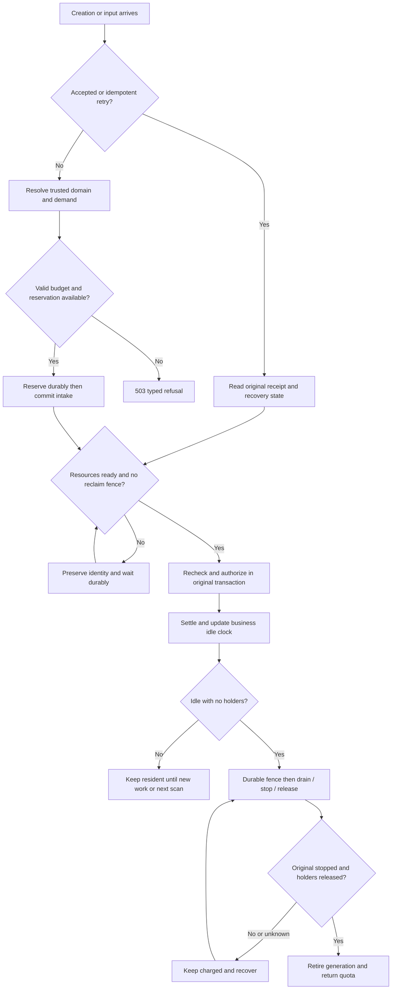
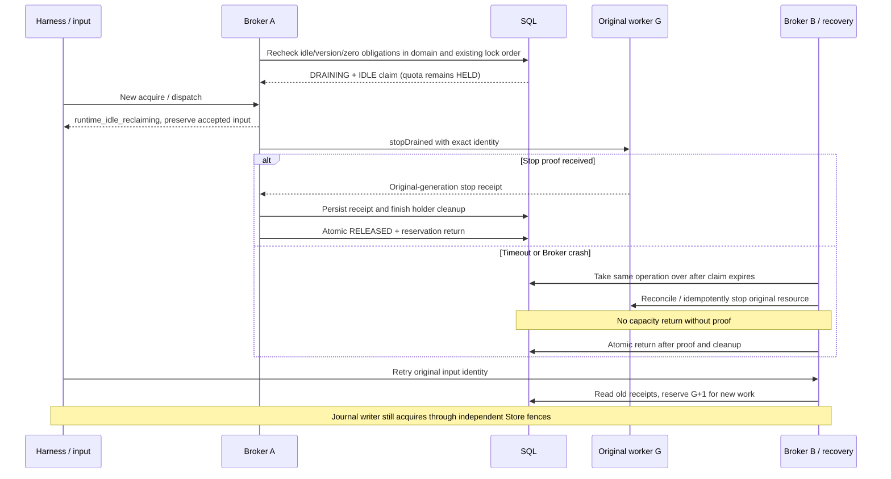

# Managed Agent capacity admission and idle reclamation

[English](2026-11-17-managed-capacity-idle-reclamation.md) | [简体中文](2026-11-17-managed-capacity-idle-reclamation.zh-CN.md)

Status: design proposal awaiting maintainer review, not implemented. Date: 2026-11-17. Source baseline: `91690e86e548125904d273761b515bd010536327`. Target: [issue #15082](https://github.com/QwenLM/qwen-code/issues/15082). This document separates current behavior, proposals and pending verification; historical tests do not establish acceptance of this design.

## 1. Problem and current state

Bound the Runtimes and Harness residency consuming resources, rather than historical Session rows. Refuse capacity shortages before accepting new work; preserve the identity of already accepted work and let it wait rather than lose it during reclamation.

| Verified current behavior                                                                                                                                                                                                                    | Constraint on this design                                                                                                 |
| -------------------------------------------------------------------------------------------------------------------------------------------------------------------------------------------------------------------------------------------- | ------------------------------------------------------------------------------------------------------------------------- |
| [#15162](https://github.com/QwenLM/qwen-code/pull/15162) merged; `ManagedAgentPreflight.capacityCheck` counts binding, Runtime Session and operation states, with physical processes and memory still `unknown`                              | Retain logical observations and add measurements and reservations; row counts are not RSS                                 |
| `LocalProcessRuntimeProvisioner` already limits startup tasks to 16 and returns `runtime_local_capacity`; the external provisioner also has a process-local placement limit                                                                  | Neither is a resident-capacity authority across Brokers; do not claim there are no capacity refusals                      |
| `findOrCreate` persists binding/seed; `admitSession` and `authorizeDispatch` recheck generation and admission under SQL locks                                                                                                                | Add reservations and reclamation fences to those transactions; JVM counters and preliminary checks are insufficient       |
| `RuntimeDrainCoordinator` already implements stop receipts, Runtime Session/holder release and binding retirement; shared bindings currently retire only with storage                                                                        | Reuse execution primitives but add idle-retirement authority; existing close does not safely reclaim shared workers as-is |
| The [parking design at the requested commit](https://github.com/QwenLM/qwen-code/blob/69d4e4cc484e6a3161e7feaaaba038a673f441d5/docs/design/2026-11-08-hosted-idle-parking.md) remains a proposal; current source lacks its automatic trigger | Parking unloads Harness state while retaining the sandbox; it cannot return Runtime capacity                              |

Section 10 lists source entry points. Early issue comments inspected `e63a0bf` and are not a current implementation inventory.

## 2. Scope and decisions

Use two reclamation layers and one durable capacity ledger:

- **Harness parking**: the Harness determines Session idleness, releases its activation and journal writer, and unloads local state while retaining the Runtime. Follow the protocol and validation constraints at the requested commit.
- **Runtime reclamation**: the Broker determines that an entire binding generation is unused, durably closes its admission, stops the original worker, releases holders, then returns capacity. Preserve the Workspace, files, Sessions and recovery evidence.
- **Capacity authority**: shared SQL records reservations and reclamation operations; trusted deployment configuration determines resource domains, never Broker instance IDs or client parameters.

Initial enforcement supports only `local-process` deployments with durable identity, exact stopping and enforceable resource limits. SSH, external and static initially report observations; each backend must pass equivalent protocol and real-process tests before enforcement. Shared Workspace reclamation is a later slice, enabled only after every condition in section 6 passes; Session-isolation tests cannot establish its safety.

Autoscaling, cross-host scheduling, killing busy Runtimes, automatically stopping MCP/Hooks, historical-record cleanup and generation memory-leak management are outside scope. Limits may refuse new work when a process leaks, but idle reclamation cannot promise to bound growth under continuously busy workloads.

## 3. Capacity model

A resource domain, `capacityDomainId`, represents one physical host or container resource pool. Every Broker/tenant sharing that physical budget must use the same domain; remote workers are not charged to the Java host. A colocated Harness belongs in the same host account. Enforcement fails startup when identity mapping cannot be proven, old workers remain uninventoried or limits cannot be enforced.

The domain budget satisfies `Bcontrol + Bharness + N × Bworker + Breserve <= Bdomain`, with `N <= maxRuntimes`. `Bworker` reserves the worker process tree, rather than Node heap or average RSS; `Bharness` covers the Harness and restore peaks. Budgets are capacity commitments; actual RSS/container memory.current is a separate observation and is not added again. Hard memory bounds require cgroup/container limits covering process trees; `--max-old-space-size` alone is insufficient. Initial deployments without isolation can only use `observe`.

Add two tables (proposed names):

| Table                     | Minimum contents and invariants                                                                                                                                                                                                                                   |
| ------------------------- | ----------------------------------------------------------------------------------------------------------------------------------------------------------------------------------------------------------------------------------------------------------------- |
| `ma_capacity_domain`      | Domain ID, policy version, mode, total budget, component reservations and `maxRuntimes`; configurations must agree within a domain. Changes lock the row and advance the version; lowering below current occupancy blocks expansion without killing existing work |
| `ma_capacity_reservation` | Unique `(domainId, bindingId, generation)`, reserved bytes, `HELD/RELEASED` and release evidence; `HELD` covers starting, READY, DRAINING and physically uncertain resources                                                                                      |

Creating a generation in `findOrCreate` and reserving capacity must share one SQL transaction: lock the domain row, count all `HELD` reservations, then use existing placement/slot/binding locks. Reusing a generation does not charge twice. A failed attempt may return capacity only when it proves no resource was created. A create timeout, Broker crash, expired claim or LOST/FAILED binding alone proves no absence. Release requires precise non-creation evidence, or original-worker stop/absence and holder-cleanup evidence. Reservations never expire automatically by TTL.

Use a durable idempotency link from `(tenant, command family, idempotency key, request digest)` to the exact reservation/generation; retries read the original link. One failed intake cannot release shared G or a reservation referenced by another request. For a completely unused G, durably close spawn/admission and verify no other intake/resource references, then obtain non-creation evidence fencing late creates before atomically retiring G, clearing its active slot and returning capacity; otherwise use normal stop recovery. Before creation or adoption, providers validate G's `HELD` reservation and live operation identity; released reservations cannot be reused.

Execution admission checks reservation identity, generation, reclamation fences and work state without acquiring a domain lock after a binding/root lock. New-generation allocation and final return both begin with the domain lock and inherit each path's existing lock order; update the lock-contract inventory and verify with real MySQL. Never perform network calls, spawn or stop inside SQL transactions.

Do not assume Harness memory is uniform per Session. Before load, each Harness reserves residency plus restore peak and limits concurrent loads; resident calls reuse their reservation. Manage that Harness's already allocated share of `Bharness` atomically in-process and reconstruct from an empty cache after restart; instances cannot each take the entire shared budget. Calibrate reservations by history size, fail and clean up safely if load exceeds its limit, and never load the full history before checking. Initial deployments use fixed budget shares per instance; dynamic allocation is outside scope.

## 4. Admission and client semantics

Propose the configuration prefix `qwen.managed-agent.capacity`: `mode=off|observe|admit|enforce` (default `observe`), trusted domain ID, domain/component budgets, `max-runtimes`, `runtime-idle-timeout` and `harness-park-after` (both timers default off). `off` preserves existing behavior; `observe` only reports; `admit` enforces reservations and refusals; `enforce` additionally enables qualified idle reclamation. Missing valid budgets must not fabricate headroom; enforcing modes require explicit configuration. Carry Harness configuration through a trusted configuration chain instead of declaring an unread Java switch.

| Entry point                                             | Rule                                                                                                                                                                                                                                                                                                                                                           |
| ------------------------------------------------------- | -------------------------------------------------------------------------------------------------------------------------------------------------------------------------------------------------------------------------------------------------------------------------------------------------------------------------------------------------------------- |
| Session creation                                        | Obtain required reservations before a successful receipt when warming/loading is needed; preserve existing idempotency on failure and leave no successful half-initialized Session. Metadata creation needing no physical resource uses no Runtime slot                                                                                                        |
| Accepting a new Turn / relay input                      | Recheck resource admission inside the existing durable intake transaction; reserve a cold Runtime before acceptance. Where cross-service allocation cannot share that transaction, reserve durably first and then commit intake; failure releases only unused reservations and crash recovery reconciles them, never treating HTTP timeout as release evidence |
| Accepted Turn / wake / recovery                         | Retry the original command/idempotency identity. Capacity shortages use existing durable waiting/rescheduling rather than terminal Harness refusal or re-execution of committed tools                                                                                                                                                                          |
| `admitSession` / `admitExecution` / `authorizeDispatch` | In their existing transactions, recheck reservation, generation, READY and absence of drain/idle-reclaim. Preliminary checks cannot replace this fence                                                                                                                                                                                                         |
| cleanup / cancel / lifecycle                            | Capacity exhaustion must not block recovery and release; preserve leases, authorization, generation and original-owner checks. Cleanup cannot create a replacement worker                                                                                                                                                                                      |

For unaccepted requests return `503 managed_capacity_exhausted` or `503 managed_capacity_unavailable`, with `retryable=true` and messages distinguishing exhausted quota from unverifiable capacity. `Retry-After` is advice, not a promise of release. A known generation being reclaimed returns `409 runtime_idle_reclaiming`; parking uses `409 hosted_session_parking`. SDK, public errors, OpenAPI, WebShell and internal callers must retain these distinctions rather than add codes that upper layers still turn into terminal failures. Public responses must not expose other tenants' occupancy details.

A Turn on an existing Runtime does not consume another Runtime slot. Pressure readings carry `source`, sample time and validity; unknown/stale readings must not be reported as normal. Hard pressure stops new work and expansion, retains cleanup headroom and alerts without killing existing work. Recovery loads still need peak reservations; they wait with original identities rather than bypass limits. Resource limits cannot guarantee every accepted Turn succeeds; OOM still follows existing recovery semantics.

## 5. Harness parking: adoption and decisions

Adopt the requested commit's Harness trigger, per-Session gate, single Store park transaction, writer lease counter, gated unknown outcomes with bounded backoff, and atomic reference-aware Java attachment/recovery-marker updates. `detach` cancels inputs and cannot substitute for park. Recheck the proposal's validation checklist before implementation; a merged document is not a completed feature.

For the original proposal's five open questions, recommend: (1) Harness owns the trigger; (2) initially pool mode only, with single-address parking disabled until a durable placement epoch or equivalent stale-load fence exists; (3) initially no parking for MCP/Hooks/background work/CSI and no automatic service restart; (4) no public PARKED lifecycle state, only operator residency reporting; (5) deduplicate and batch reads first, retain all restore verification and reject verification-skipping option (c). These are recommendations in this proposal, not accepted maintainer decisions.

The historical rig's 51–56 statements per idle minute, approximately 870 statements per earlier Turn and approximately 85 ms per earlier Turn came from one scripted-model run in the original document. They are neither new measurements nor production capacity constants. Reduce and measure load cost first, then choose `harness-park-after` from idle savings and wake latency instead of copying a timeout default. Successful park returns only Harness residency allocations; the Runtime reservation remains `HELD`.

## 6. Runtime idle retirement

**Idle facts.** Add binding `idle_since` and monotonic `activity_version`, maintained in the original transactions for business acquire, execution admission, settlement and Runtime Session/holder release. The idle start is database time when the latest business work completes and all obligations reach zero. Heartbeats, writer renewals and maintenance scans do not refresh it. Maintenance changes `last_active_at`, so that field cannot be reused. New business clears idle and advances the version; a timeout only identifies a candidate.

Initialize idle time on first READY with zero obligations, including workers warmed for models that never call a tool. Warm is business activity: advance the version and restart idle time when obligations are zero without creating a permanent hold. Adoption after restart preserves the durable business clock; if no trustworthy start exists, conservatively start at current database time rather than infer a long idle period.

**Atomic claim.** Scan candidates in bounded pages and recheck under the generation lock shared by admission: READY, unchanged version, elapsed timeout, no unsettled intake/undelivered relay references, no live Runtime Session/Workspace holder, no active or uncertain execution, no background Shell/Monitor/MCP/Hook hold, and no recovery/lifecycle/migration conflict. Skip unknown states. Persist `drain_reason=IDLE`, operation claim and DRAINING in the same transaction as these checks. Version and state checks must cover the warm-to-acquire gap; new acquire/dispatch and this claim are mutually exclusive.

**Execution.** Extract the smallest shared execution segment from existing drain/stop/receipt/holder-release, retaining authorization at each entry. Idle reclamation does not set a permanent Harness drain fence, close a Workspace or retire storage. Shared workers require generation-scoped IDLE authorization replacing the current storage-fenced precondition, and every Session on that binding must already be released. Do not loosen ordinary close authorization. Keep workers whose dependencies cannot be proven absent.

**Completion and recovery.** Persist a stop receipt matching `(bindingId, generation, seed, resourceHandle, lease)`, verify all holders released, then mark the old binding RELEASED and return its unique reservation in a transaction beginning with the domain lock. Unknown outcomes remain charged; another Broker takes the same operation over using database-time leases and a higher operation generation. Late callbacks from old owners cannot stop or release a new generation. Cancel/delete must converge on that operation rather than start another stop. Preserve process receipts, old Runtime Session tombstones and tool results under existing retention protocols.

Maintenance, recovery and adoption recognize durable `drain_reason=IDLE` before ordinary reconciliation and delegate to the same idle-retirement operation. They must not interpret a normal stop as journal loss, enter `cleanupLost` or start another worker. Current `RuntimeBindingProvisioning.retirementOwns` only recognizes Harness close/storage fences and must be extended; existing `lookupOnly` reads may observe original evidence but cannot take retirement ownership away.

**Wake boundary.** New work waits for the old generation to finish and then reserves and creates G+1 under the same request key. Read and clean old receipts and old Runtime Session IDs on G; never remap them to new execution on G+1. Before enabling reclamation, complete four compatibility changes: revalidate warmed G before acquire; settle old-G cleanup obligations using stop proof; read a RELEASED Runtime Session's tombstone before starting another worker; and let child relay/recovery recognize retired owners while preserving delivery identity. The resident-runtime section 4.5 linked in section 10 already identifies these races; they are enablement conditions.

## 7. Operations, delivery and rollback

Extend existing `--check` with domain/policy validity, logical counts, `HELD` count and reserved bytes, memory measurement source/time, and idle candidates/blockers. Keep checks read-only. Add a capacity deep-health contribution protected by existing operator authentication. Shallow liveness does not depend on capacity; exhaustion is degraded with a reason and must not make readiness remove the whole service when every node is full. Do not expose process identity, credentials or cross-tenant details without authorization.

Delivery order: (1) domains, process inventory and observation; (2) ledger, atomic admission and error consumers; (3) parking reference compatibility, cheaper load and safe protocol; (4) Session-isolated Runtime idle retirement; (5) shared Workspace generation fences and wake compatibility. Step 2 does not depend on parking; steps 4/5 cannot infer safe worker stop from successful parking. Each slice starts in observation and requires independent acceptance before explicit enablement.

Before first enabling `admit/enforce`, pause new allocation, inventory every existing worker, and import it as `HELD` by exact identity. Unreconciled resources are unknown occupancy and block expansion. The domain row is the shared mode/policy authority; old Brokers cannot bypass the ledger and incompatible versions must stop rather than coexist in enforcement. Edit the shared V1 schema under the pre-release policy instead of adding V2 migrations.

Rollback first stops new reclamation claims and then converges existing DRAINING operations. Returning to `observe` does not clear reservations, receipts or fences or interrupt existing work. Roll binaries back only after new-protocol operations finish and schema compatibility is confirmed. Real workloads determine timeouts, budget shares and pressure thresholds; automatic reclamation remains disabled until maintainers approve values.

## 8. Verification and acceptance criteria

| Required behavior                                                                                 | Required evidence                                                                                                                                                        |
| ------------------------------------------------------------------------------------------------- | ------------------------------------------------------------------------------------------------------------------------------------------------------------------------ |
| Two Brokers/tenants contend for the last domain slot; idempotent retries and policy decreases     | Real MySQL 8.4: at most one new resource, no duplicate reservation and no eviction of existing resources                                                                 |
| Crash after reserve, lost contact after spawn, lost stop response, late old owner                 | Real worker and fault injection: unknown remains charged, exactly one return after stop/cleanup proof, no killing G+1                                                    |
| Idle claim races acquire/dispatch/close/migration                                                 | MySQL transaction tests: exactly one side wins admission or reclamation, no root/binding/domain lock inversion                                                           |
| Continuing heartbeat/maintenance; long Turn, approval, pending input or MCP/Hooks/background hold | Renewals do not refresh business idle time; holders are not reclaimed; park still checks pending input                                                                   |
| Warm succeeds without acquire, followed by Broker restart and maintenance scans                   | Worker still becomes a candidate by business idle time; the same operation converges IDLE retirement without false journal loss                                          |
| Warm-to-acquire, old Session tombstone, child relay, shared Workspace with multiple Sessions      | Old-G cleanup settles; old retries do not trigger cold start before rejection; no lost delivery, tool replay or stopping another Session's worker                        |
| 503/409 across public API, SDK, WebShell, prompt/relay/wake/lifecycle                             | Contract tests and E2E: unaccepted requests retry, accepted work waits durably, cancel/cleanup progress                                                                  |
| Parking refusals, unknown outcomes, reload, lease counter, stale attachment and late heartbeat    | Deterministic Harness/Store tests and real-process races from the original proposal, not only eventual Turn success                                                      |
| Histories of 1/40/200 Turns and colocated mixed load                                              | Record load p95, SQL/minute, process-tree memory, reserved and resident counts; prove bounded peaks and idle savings while retaining corrupted-resource restore refusals |

Implementation first needs a `.qwen/e2e-tests/` plan and a dry run against global `qwen`, distinguishing scripted models from real providers. Local Java checks share the module's ten-minute budget; transactions/recovery need focused MySQL and real Hosted paths, with complete MySQL/Hosted/fault profiles in CI. Cross-language changes also need root build/typecheck and affected unit tests. Public-contract changes run `ManagedAgentApiContractTest` and `SurfaceRegistryGateTest` and regenerate consumer types.

Acceptance must establish all of: new admission stays within the domain budget (report existing overcommit after a policy decrease and block expansion), unknown outcomes do not free capacity, idle workers physically stop, Sessions remain usable without duplicate execution, and operators can distinguish logical state/reservation/measurement. Reporting or parking alone cannot close #15082. The implementation slice and its validation boundaries are recorded in section 11; the full runtime acceptance above remains pending.

## 9. Independent audit

The same independent Sub Agent completed two rounds of forward and reverse audits. Round one identified three issues, all revised: durable idempotent reservation-to-intake handoff and late-create fencing; IDLE retirement ownership over maintenance/recovery; and idle-clock initialization after warm without acquire. The second full audit found no unaddressed design blockers and confirmed language alignment; the English evidence-link fragment was also corrected.

The forward audit covered requirements through model, admission, reclamation, recovery, operations and acceptance. The reverse audit covered cross-Broker overselling, crashes/unknown outcomes, shared workers, old generations/attachments, lock ordering, mixed versions and rollback. This evaluates design protocols only; real MySQL/Hosted/fault, process-tree limits, performance data and maintainer decisions remain subject to section 8 verification.

## 10. Evidence and implementation entry points

- [Issue and its four comments](https://github.com/QwenLM/qwen-code/issues/15082), [#15162](https://github.com/QwenLM/qwen-code/pull/15162), [parking commit](https://github.com/QwenLM/qwen-code/commit/69d4e4cc484e6a3161e7feaaaba038a673f441d5).
- [Existing capacity observation](2026-10-22-managed-capacity-observation.md), [full parking proposal](2026-11-08-hosted-idle-parking.md), [resident-runtime section 4.5](2026-10-15-managed-workspace-resident-runtime.md#45-deferred-idle-retirement-and-generation-budget).
- Under `packages/managed-agent-server/`: `server/.../preflight/ManagedAgentPreflight.java` (`capacityCheck`); `persistence/.../JdbcRuntimeBindingRepository.java` (`findOrCreate`, `admitSession`, `admitExecution`, `authorizeDispatch`); `persistence/.../RuntimeAdmissionFences.java`; `runtime-broker/.../RuntimeBindingProvisioning.java`, `RuntimeDrainCoordinator.java`, `RuntimeSessionRelease.java`; `runtime-local/.../LocalProcessRuntimeProvisioner.java`; `runtime-external/.../ExternalRuntimeProvisioner.java`. Abbreviations stand for each module's `src/main/java/com/alibaba/qwen/code/` and Java package directories; identifiers refer to the pinned source baseline.
- Harness: `packages/cli/src/serve/hosted-harness-session.ts`, `managed-session-assembly.ts`, `managed-session-authority.ts`, `http-managed-session-store.ts`; Java: `QwenHostedHarnessConnector`, `HarnessCoordinator`, `JournalWriterLifecycle`. Legacy: `packages/acp-bridge/src/daemon-memory-budget.ts`, `packages/cli/src/serve/daemon-memory-pressure.ts`, `idle-acp-reclamation.ts`; reuse budget/pressure vocabulary and rollout modes, not in-process authority.

## 11. Implementation progress

The current increment implements observation and durable estimated reservation accounting, not the full enforcement/reclamation proposal. With an explicit trusted local-process domain and budgets, the binding transaction records one reservation per generation across Brokers and rejects inconsistent domain identity/policy. New allocation in observe mode continues when budgets are exceeded; operator preflight reports over-budget estimates as WARN. A missing domain leaves binding records explicitly unaccounted; neither a record count nor a reservation is presented as a physical process or measured RSS.

Normal retirement and lost-binding completion return an observed reservation only with original-worker stop evidence. FAILED/LOST and expired claims do not release it, and retention cannot delete a binding whose reservation is HELD. Released reservation rows retain their stop evidence. Existing worker inventory is not automatically attributed to a host; existing unaccounted generations remain unaccounted until a future explicit host-attestation backfill, and gaps remain visible.

Only `capacity.mode=off|observe` is implemented; `admit/enforce` fail configuration validation. Typed capacity admission, intake handoff, physical memory limits/pressure sampling, deep health, automatic Harness parking, Runtime idle clocks and automatic retirement remain unimplemented and disabled. This increment does not close #15082. It changes the pre-release V1 baseline: recreate development catalogs rather than attempt migration, and deploy matching server/Broker schema consumers together.

Validation on macOS 27.0/aarch64 with Homebrew JDK 21.0.12.1 and Maven 3.10.0 used an isolated `/tmp/qwen-15082-implementation-m2` repository with the current Java SDK installed first. From `packages/managed-agent-server/`, `mvn -Dmaven.repo.local=/tmp/qwen-15082-implementation-m2 -Dtest=JdbcRuntimeCapacityTest,ManagedSchemaTest,ManagedSchemaTimeContractTest,ManagedAgentPreflightTest,ManagedAgentPropertiesTest,RuntimeBrokerConfigurationTest,JdbcRuntimeRetentionTest,ManagedRuntimeCapacityTest,ClassSizeRatchetTest test checkstyle:check` completed with 176 tests, zero failures/errors, ten skips and zero Checkstyle violations. A subsequent run covering the added retention case passed 28/28 selected capacity/retention tests and the one new selected `mysql-integration` case through `failsafe:integration-test failsafe:verify`. That case used MySQL 8.4.11 in Docker with `max_allowed_packet=134217728`, native AIO disabled and binlog off; the CI image is 8.4.6, so the patch version differs. It validates shared SQL accounting and unknown-FAILED retention, not physical worker stopping or capacity enforcement. Task-owned container and database were removed.

The initial offline attempt failed on a missing cached dependency; an online retry compiled but found semicolons in new SQL comments incompatible with the existing DDL splitter (174 tests, 51 errors). Both issues were corrected before the successful runs above. Config-reference generation/check and Markdown/reference/diagram checks passed. Full unit/H2, MySQL and Hosted/fault CI, physical worker limits, performance qualification and enforcement remain pending. The implementation received an independent code audit: both first-round findings (unproven old-worker attribution and a narrowed identifier byte budget) were fixed, and re-review found no remaining blocker for this observation slice.
