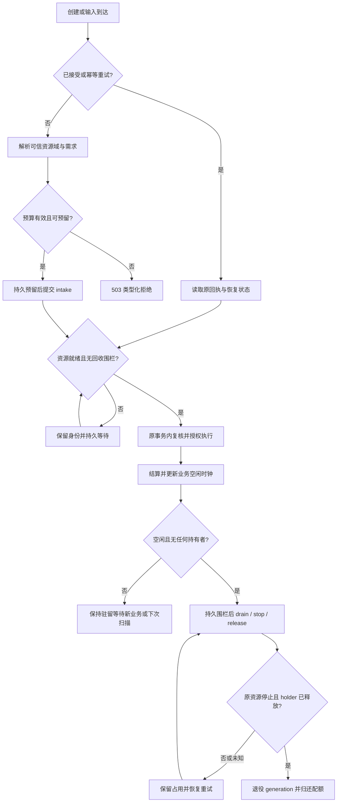
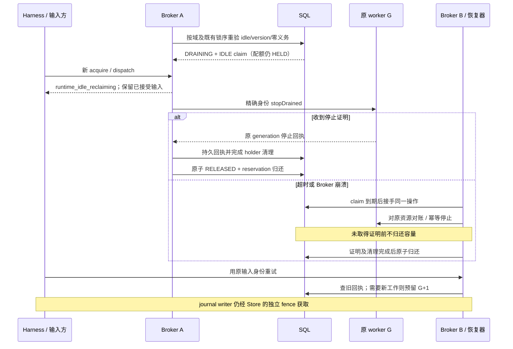

# Managed Agent 容量准入与空闲回收

[English](2026-11-17-managed-capacity-idle-reclamation.md) | [简体中文](2026-11-17-managed-capacity-idle-reclamation.zh-CN.md)

状态：待维护者评审的设计提案，未实现。日期：2026-11-17。源码基线：`91690e86e548125904d273761b515bd010536327`。目标：[issue #15082](https://github.com/QwenLM/qwen-code/issues/15082)。本文区分现状、提案与待执行验证，不以历史测试代替本方案验收。

## 1. 问题与现状

需要限制的是正在占用资源的 Runtime 与 Harness 驻留状态，而不是历史 Session 行数。容量不足应在接受新工作前明确拒绝；已经接受的工作保留身份并等待，不能因回收而丢失。

| 已核实的现状                                                                                                                                                                                      | 对本设计的约束                                                               |
| ------------------------------------------------------------------------------------------------------------------------------------------------------------------------------------------------- | ---------------------------------------------------------------------------- |
| [#15162](https://github.com/QwenLM/qwen-code/pull/15162) 已合入；`ManagedAgentPreflight.capacityCheck` 统计 binding、Runtime Session、operation 状态，物理进程和内存仍为 `unknown`                | 保留逻辑观测，补充实测与预留，不能把逻辑行数当 RSS                           |
| `LocalProcessRuntimeProvisioner` 的 16 个启动任务上限与 `runtime_local_capacity`，以及 external provisioner 的进程内 placement 上限均已存在                                                       | 它们不是跨 Broker 的常驻容量权威，不重复宣称“没有任何容量拒绝”               |
| `findOrCreate` 持久化 binding/seed；`admitSession`、`authorizeDispatch` 在 SQL 锁下复核 generation 和准入                                                                                         | 新容量预留与回收围栏必须加入这些事务；JVM 计数器和前置检查不足               |
| `RuntimeDrainCoordinator` 已有 stop 回执、Runtime Session/holder 释放和 binding 退役；共享 binding 目前只允许随 storage 退役                                                                      | 复用执行原语，但新增空闲退役授权；不能假装现有 close 已能安全回收共享 worker |
| [指定提交的 parking 设计](https://github.com/QwenLM/qwen-code/blob/69d4e4cc484e6a3161e7feaaaba038a673f441d5/docs/design/2026-11-08-hosted-idle-parking.zh-CN.md) 仍是提案；当前源码无其自动触发器 | parking 释放 Harness 状态、保留沙箱，不能归还 Runtime 配额                   |

源码入口列于第 10 节。issue 早期评论基于 `e63a0bf`，不能直接作为当前实现清单。

## 2. 范围与决策

采用两层回收、一个持久容量账本：

- **Harness parking**：由 Harness 判断 Session 是否空闲，释放 activation 与 journal writer 后卸载本地状态，保留 Runtime。沿用指定提交的协议设计及验证约束。
- **Runtime 回收**：由 Broker 判断整个 binding generation 是否无人使用，持久关闭其准入，停止原 worker，释放 holder，再归还容量。保留 Workspace、文件、Session 和恢复证据。
- **容量权威**：共享 SQL 记录预留与回收操作；资源域由可信部署配置决定，不能用 Broker 实例 ID 或客户端参数决定。

首批强制模式限定为支持持久身份、精确停止和资源限额的 `local-process` 部署。SSH、external 和 static 先提供观测；每个后端通过同等协议与真实进程测试后才能开启强制模式。共享 Workspace 回收是后续切片，必须完成第 6 节的全部条件才能开启；不能用 Session 隔离测试推断其安全性。

不做自动扩缩容、跨主机调度、强杀繁忙 Runtime、自动停止 MCP/Hooks、历史记录清理或 generation 内存泄漏治理。进程因泄漏达到限制时可拒绝新工作，但不能承诺空闲回收解决持续繁忙时的增长。

## 3. 容量模型

**资源域 `capacityDomainId`** 对应一个物理主机或一个容器资源池。共享该物理预算的所有 Broker/租户必须使用同一域；远端 worker 不计入 Java 主机预算。Harness 若与 worker 同机，计入同一主机总账。身份映射无法证明、旧 worker 尚未盘点或限制无法落实时，强制模式启动失败。

域预算满足：`Bcontrol + Bharness + N × Bworker + Breserve <= Bdomain`，并要求 `N <= maxRuntimes`。`Bworker` 是包含 worker 子进程的资源预留，不是 Node heap 或平均 RSS；`Bharness` 覆盖 Harness 及加载峰值。预算是容量承诺，实际 RSS/容器 memory.current 是独立观测，不相加重复计费。要声称硬内存上限，必须由 cgroup/容器等限制进程树；仅设置 `--max-old-space-size` 不够。首批无法隔离时只能 `observe`。

新增两张表（均为提议名称）：

| 表                        | 最小内容与不变量                                                                                                                             |
| ------------------------- | -------------------------------------------------------------------------------------------------------------------------------------------- |
| `ma_capacity_domain`      | 域 ID、策略版本、模式、总预算、各组件预留、`maxRuntimes`；同域配置必须一致。变更加锁、递增版本；下调到当前占用以下时只阻止扩容，不杀已有工作 |
| `ma_capacity_reservation` | 唯一 `(domainId, bindingId, generation)`、预留字节、`HELD/RELEASED`、释放证据；`HELD` 同时覆盖启动中、READY、DRAINING 和结果未知的物理资源   |

`findOrCreate` 创建新 generation 与获取预留必须在同一个 SQL 事务内完成：先锁域行，计算所有 `HELD`，再使用既有 placement/slot/binding 锁。复用旧 generation 不重复扣费。失败且能证明从未产生资源时可归还；创建请求超时、Broker 崩溃、claim 过期、binding 为 LOST/FAILED 均不能单独证明资源消失。只凭精确的未创建证明，或原 worker 停止/不存在及 holder 清理证明归还。reservation 不按 TTL 自动释放。

预留与 intake 使用持久幂等关联：保存 `(tenant, command family, idempotency key, request digest)` 到确切 reservation/generation 的关联；重复请求读取原关联。一次 intake 失败不能释放共享 G 或其他请求引用的预留。对完全未使用的 G，先持久关闭 spawn/准入并确认无其他 intake/资源引用，取得阻断迟到创建的未创建证明后，才原子退役 G、清除 active slot 并归还；否则走正常停止恢复。provider 必须在创建与采用前验证该 G 的 `HELD` 及有效操作身份，已释放的预留不得复用。

执行准入只验证 reservation 身份、generation、回收围栏与工作状态，不在持有 binding/root 锁后反向获取域锁。新 generation 分配与最终归还均从域锁开始，继承各路径现有的锁序；必须更新 lock-contract 清单并用真实 MySQL 验证。SQL 事务中不做网络、spawn 或 stop。

Harness 内存不能按 Session 数假定均摊。每个 Harness 在 load 前预留“驻留 + 恢复峰值”，并限制并发 load；已经驻留的调用复用预留。单进程内原子管理该份已从域预算划出的 `Bharness`，实例重启从空缓存重建；跨实例不得各自领取整份共享预算。按历史大小校准预留，load 超出限额时安全失败并清理，不能先加载全部历史再检查。首批采用部署固定的每实例预算份额；动态份额分配不在范围内。

## 4. 准入与客户端语义

新增拟议配置前缀 `qwen.managed-agent.capacity`：`mode=off|observe|admit|enforce`（默认 `observe`）、可信域 ID、域与组件预算、`max-runtimes`、`runtime-idle-timeout`、`harness-park-after`（后两者默认关闭）。`off` 不改变现有行为；`observe` 只报告；`admit` 执行预留与拒绝；`enforce` 再开启已资格验证的空闲回收。无有效预算时不伪造余量；强制模式要求显式配置。Harness 配置需通过受信任的配置链传递，不能只在 Java 声明无人读取的开关。

| 入口                                                    | 规则                                                                                                                                                                                               |
| ------------------------------------------------------- | -------------------------------------------------------------------------------------------------------------------------------------------------------------------------------------------------- |
| 创建 Session                                            | 需要 warm 或加载时，成功回执前取得所需预留；失败保留现有幂等约束，不留下成功的半初始化 Session。不需物理资源的元数据创建不消耗 Runtime 名额                                                        |
| 接受新 Turn / relay 输入                                | 在现有持久 intake 事务中复核所需资源可准入；冷 Runtime 预留须在接受前完成。与跨服务资源分配无法同事务时，先持久预留，再提交 intake；失败释放仅未使用预留，崩溃由恢复对账，不以 HTTP 超时为释放依据 |
| 已接受的 Turn / wake / 恢复                             | 沿原 command/idempotency 身份重试。容量不足进入已有持久等待/重排期路径，不标成终态 Harness 拒绝，不重新执行已提交工具                                                                              |
| `admitSession` / `admitExecution` / `authorizeDispatch` | 在原事务内复核预留、generation、READY 且未 drain/idle-reclaim。外层预检不能代替这道 fence                                                                                                          |
| cleanup / cancel / lifecycle                            | 不因“满载”阻止恢复和释放；保留既有租约、权限、generation 及原 owner 检查，不能借 cleanup 之名新建替代 worker                                                                                       |

对尚未接受的请求返回 `503 managed_capacity_exhausted` 或 `503 managed_capacity_unavailable`，`retryable=true`，消息区分“配额已满”和“无法确认容量”。`Retry-After` 只表示重试建议，不承诺释放时间。回收中的已知 generation 返回 `409 runtime_idle_reclaiming`，parking 使用 `409 hosted_session_parking`。SDK、公有错误模型、OpenAPI、WebShell 和各内部调用方都必须保留这些分类；不能只增加错误码而让上层仍转成终态失败。公开应答不泄露其他租户占用明细。

已有 Runtime 内的 Turn 不重复消耗 Runtime 名额。内存压力来源需携带 `source`、采样时间和有效期，未知/过期不能报正常；压力超硬阈值时停止新工作和扩容，保留清理余量并告警，既有工作不被强杀。恢复 load 同样必须拿到峰值预算；额度不足保留原身份等待，不绕过限额。资源上限不能保证每个已接受 Turn 一定成功，OOM 等仍按现有恢复语义处理。

## 5. Harness parking：采纳与收敛

采纳指定提交的 Harness 触发器、按 Session 闸门、Store 单事务 park、writer lease counter、结果未知时保持闸门并有界退避，以及按引用原子更新 Java attachment/recovery marker 的规则。`detach` 会取消输入，不能当作 park。实现前逐项复核该设计的验证清单，不能把文档合入当作功能已完成。

对原提案五个开放问题，本方案建议：① Harness 触发；② 首批 pool 模式，单地址保持关闭，直到增加持久 placement epoch 或提供同等 stale-load fence；③ 首批 MCP/Hooks/后台任务/CSI 均不 park，不自动重启服务；④ 公共 Session 生命周期不新增 PARKED 状态，仅运维面显示 residency；⑤ 先去重读与批量读取，保留全部 restore 校验，不采用跳过验证的方案 (c)。这些是本方案建议，尚非维护者已接受决议。

历史 rig 的 51–56 条语句/空闲分钟、约 870 条语句/历史 Turn 与约 85 ms/历史 Turn 来自原文一次脚本模型测试，不是本次实测，也不是生产容量常量。先降低并测量 load 成本，再依据空闲收益与唤醒延迟决定 `harness-park-after`；不得直接抄一个超时默认值。成功 park 只归还 Harness 驻留份额，Runtime reservation 保持 `HELD`。

## 6. Runtime 空闲退役

**空闲事实。** 新增 binding 的 `idle_since` 和单调 `activity_version`，在业务 acquire、执行准入、结算、Runtime Session/holder 释放的原事务中维护。起点是最近业务工作完成且所有义务归零的数据库时间；heartbeat、writer 续约和维护扫描不刷新它。`last_active_at` 会被维护改写，不能复用。新业务先清空 idle 并推进版本；timeout 只是候选条件。

首次 READY 且零义务时即初始化空闲起点，覆盖 warm 后模型从未调用工具的 worker。warm 属业务活动，推进版本后在零义务时重新开始计时，但不创建永久 hold。重启采用延续持久业务时钟；缺少可信起点时，从当前数据库时间保守计时，不能推断它已空闲很久。

**原子认领。** 有界分页扫描候选，在既有准入共用的 generation 锁下重验：READY、版本未变、已超过超时、无未结算 intake/待交付 relay 引用、无有效 Runtime Session/Workspace holder、无活动或不确定执行、无后台 Shell/Monitor/MCP/Hook 持有、无恢复/生命周期/迁移冲突。存在未知状态即跳过。持久写入 `drain_reason=IDLE`、操作 claim 和 DRAINING，与上述复核同一事务。`activity_version` 与状态检查必须覆盖 warm→acquire 的空档；任何新 acquire/dispatch 都与该认领互斥。

**执行。** 将现有 drain/stop/receipt/holder-release 链抽出最小公共执行段，入口仍各自校验授权。空闲路径不设置 Harness 的永久 drain fence，不关闭 Workspace，不写 storage 退役状态。共享 worker 要增加 generation 级 IDLE 授权，替换现有“必须 storage fenced”的前置条件；只有整个 binding 的所有 Session 均释放才可进入。不得放宽普通 close 的授权。无法证明无依赖时保留 worker。

**完成与恢复。** 精确匹配 `(bindingId, generation, seed, resourceHandle, lease)` 的停止回执持久化后，确认 holder 全部释放，再在域锁开始的事务中将旧 binding 标为 RELEASED 并归还唯一 reservation。结果未知继续占用；其他 Broker 用数据库时间租约和更高 operation generation 接手同一操作。旧 owner 的迟到回调不得停止或释放新 generation。取消或删除请求也要与该操作收敛，不能另起一次 stop。进程回执、旧 Runtime Session tombstone 与工具结果按现有保留协议保存。

maintenance、recovery 与 adoption 必须在普通 reconcile 之前识别持久 `drain_reason=IDLE`，交给同一个空闲退役操作；不得将正常停止解释为 journal 丢失、转入 `cleanupLost`，或另起 worker。当前 `RuntimeBindingProvisioning.retirementOwns` 只识别 Harness close/storage fence，必须同步扩展；既有 `lookupOnly` 读取仍可观察原证据，但不能夺走退役归属。

**唤醒边界。** 新工作等待旧 generation 完成，随后按相同 request key 预留并创建 G+1；旧回执与旧 Runtime Session id 始终在 G 上读取和清理，不得映射成 G+1 的新执行。开启回收前必须完成四项兼容：warm 的旧 G 引用在 acquire 前重新验证；旧 G 的清理义务能在停止证明下结算；已 RELEASED 的 Runtime Session 重试先查 tombstone，不能先启动新 worker；child relay/恢复入口能识别已退役 owner 并保留原投递身份。第 10 节的 resident-runtime §4.5 已指出这些竞态，它们是开启条件。

## 7. 运维、交付与回滚

扩展现有 `--check`：输出域/策略有效性、逻辑计数、`HELD` 数及预留字节、实测内存的来源/时间、idle 候选与阻塞原因。检查保持只读。新增受现有运维认证保护的容量深度健康贡献项，浅层 liveness 不依赖容量；满载显示 degraded 并给出原因，不能因所有节点满载而让 readiness 把整个服务摘除。不得无认证暴露进程身份、凭据或跨租户明细。

切片顺序：① 资源域/进程盘点与观测；② 账本、原子准入和错误消费；③ parking 的引用兼容、load 降本与安全协议；④ Session 隔离的 Runtime 空闲退役；⑤ 共享 Workspace 的 generation 围栏与唤醒兼容。② 不依赖 parking；④/⑤ 不能借 parking 成功就认定 worker 可停止。每片默认只观测，独立验收后显式开启。

首次启用 `admit/enforce` 前暂停新资源分配并盘点全部存量 worker，将其按精确身份导入 `HELD`；无法对账的资源计为未知占用并阻止扩容。模式或策略由域行作为共同权威，不能让旧 Broker 绕过账本；不兼容旧版本必须停止，不能混部强制模式。按首发前约定修改共享 V1 schema，不添加 V2 migration。

回滚先停止新回收认领，再收敛已经 DRAINING 的操作；切回 `observe` 不清除 reservation、回执或 fence，不中断既有工作。仅在所有新协议操作完成且 schema 兼容得到确认后回滚二进制。默认超时、份额和压力阈值由真实负载测量决定；维护者批准数值前不启用自动回收。

## 8. 验证与接受标准

| 必须验证的行为                                                             | 证据要求                                                                                                   |
| -------------------------------------------------------------------------- | ---------------------------------------------------------------------------------------------------------- |
| 两 Broker、两租户抢最后一个域名额；幂等重试与配置下调                      | 真实 MySQL 8.4：至多一个新资源；reservation 不重复，现存资源不被踢出                                       |
| 预留后崩溃、spawn 后失联、stop 应答丢失、旧 owner 迟到                     | 真实 worker + 故障注入：未知继续计费；停止与清理证明后只归还一次；不误杀 G+1                               |
| idle 认领与 acquire/dispatch/close/migration 同时发生                      | MySQL 事务测试：准入或回收恰好一方获准；无 root/binding/domain 锁序反转                                    |
| 心跳与维护持续运行；长 Turn、审批、待处理输入、MCP/Hooks/后台任务仍在      | 业务时钟不被续约刷新；持有者不被回收；park 的 pending-input 检查仍然有效                                   |
| warm 成功却从未 acquire；随后 Broker 重启和 maintenance 扫描               | worker 仍按业务空闲时钟成为候选；IDLE 退役由同一操作收敛，不误报 journal 丢失                              |
| warm→acquire、旧 Session tombstone、child relay、共享 Workspace 多 Session | 原 G 清理可完成；无冷启动后才发现旧重试；不丢投递、不重放工具、不停止其他 Session 的 worker                |
| 503/409 经 public、SDK、WebShell、prompt/relay/wake/lifecycle 传播         | 契约与 E2E：未接受请求可重试；已接受工作持久等待；cancel/cleanup 可前进                                    |
| parking 拒绝、未知结果、重载、lease counter、过期 attachment、晚到心跳     | 原提案的 Harness/Store 确定性测试与真实进程竞态全部覆盖，不能只测最终 Turn 成功                            |
| 1/40/200 Turn 历史与同机混合负载                                           | 记录 load p95、SQL/分钟、进程树内存、预留与驻留量；验证 peak 受限及 idle 收益，保留损坏资源的 restore 拒绝 |

实现时先建立 `.qwen/e2e-tests/` 计划并对全局 `qwen` dry-run，区分脚本模型与真实 provider。本地 Java 检查遵守模块 10 分钟共享预算；事务/恢复需定向 MySQL 与真实 Hosted 路径，完整 MySQL/Hosted/fault profile 留给 CI。跨语言改动还需根 build/typecheck 和受影响单测；公开契约改动运行 `ManagedAgentApiContractTest`、`SurfaceRegistryGateTest` 并重新生成消费者类型。

验收必须同时证明：新准入不超域预算（策略下调造成的存量超额明确报告并阻止扩容）、未知不释放、空闲 worker 确实停止、Session 可继续使用且无重复执行、运维可区分逻辑状态/预留/实测。只完成报告或 parking 均不能关闭 #15082。实际实施切片与验证边界见第 11 节；上述完整运行时验收仍待完成。

## 9. 独立审计

同一个独立 Sub Agent 已完成两轮正向与反向审计。首轮发现并修订三项：预留与 intake 的持久幂等交接及迟到创建围栏；IDLE 退役对 maintenance/recovery 的归属；warm 后从未 acquire 的空闲计时起点。第二轮完整复审确认无未处理设计阻断项，中英文一致；英文依据链接的锚点也已修正。

正向审计覆盖需求到模型、准入、回收、恢复、运维和验收；反向覆盖跨 Broker 超卖、崩溃与未知结果、共享 worker、旧 generation/attachment、锁序和混部回滚。该结论只评价设计协议；真实 MySQL/Hosted/fault、进程树限额、性能数据与维护者决策仍按第 8 节验证。

## 10. 依据与实现入口

- [issue 及四条评论](https://github.com/QwenLM/qwen-code/issues/15082)、[#15162](https://github.com/QwenLM/qwen-code/pull/15162)、[parking 提交](https://github.com/QwenLM/qwen-code/commit/69d4e4cc484e6a3161e7feaaaba038a673f441d5)。
- [现有容量观测设计](2026-10-22-managed-capacity-observation.zh-CN.md)、[parking 完整提案](2026-11-08-hosted-idle-parking.zh-CN.md)、[resident-runtime §4.5](2026-10-15-managed-workspace-resident-runtime.zh-CN.md#45-推后空闲回收与-generation-预算)。
- `packages/managed-agent-server/` 下：`server/.../preflight/ManagedAgentPreflight.java`（`capacityCheck`）；`persistence/.../JdbcRuntimeBindingRepository.java`（`findOrCreate`、`admitSession`、`admitExecution`、`authorizeDispatch`）；`persistence/.../RuntimeAdmissionFences.java`；`runtime-broker/.../RuntimeBindingProvisioning.java`、`RuntimeDrainCoordinator.java`、`RuntimeSessionRelease.java`；`runtime-local/.../LocalProcessRuntimeProvisioner.java`；`runtime-external/.../ExternalRuntimeProvisioner.java`。省略的路径为各模块的 `src/main/java/com/alibaba/qwen/code/` 及其 Java 包目录，标识符对应上述源码基线。
- Harness：`packages/cli/src/serve/hosted-harness-session.ts`、`managed-session-assembly.ts`、`managed-session-authority.ts`、`http-managed-session-store.ts`；Java：`QwenHostedHarnessConnector`、`HarnessCoordinator`、`JournalWriterLifecycle`。旧路径：`packages/acp-bridge/src/daemon-memory-budget.ts`、`packages/cli/src/serve/daemon-memory-pressure.ts`、`idle-acp-reclamation.ts`；只复用预算/压力表达与模式思想，不移植进程内权威。

## 11. 实施进度

本次增量实现观测与持久估算预留核算，不代表整份强制准入/回收提案已实现。显式配置受信任的 local-process 资源域及预算后，binding 事务跨 Broker 为每个 generation 记录唯一预留，并拒绝不一致的域身份或策略。observe 模式超出预算仍允许新分配，运维 preflight 将估算超额报为 WARN。没有域配置的 binding 记录明确标为未核算；逻辑记录数和预留均不冒充物理进程数或实测 RSS。

正常退役与丢失 binding 完成恢复时，只凭原 worker 停止证明归还观测预留。FAILED/LOST 和 claim 过期不释放，retention 不得删除仍有 HELD 预留的 binding；已释放预留行保留停止证据。不自动把存量 worker 归属某主机，既有未核算 generation 必须等待后续显式主机身份证明回填，当前缺口保持可见。

仅实现 `capacity.mode=off|observe`，`admit/enforce` 在配置验证时拒绝。类型化容量准入、intake 交接、物理内存限额/压力采样、深度健康、自动 Harness parking、Runtime 空闲时钟和自动退役均未实现且保持关闭。本增量不能关闭 #15082。它修改首发前 V1 基线：应重建开发 catalog，不做迁移；部署时同步更新 server/Broker 的 schema 消费者。

本地验证环境为 macOS 27.0/aarch64、Homebrew JDK 21.0.12.1、Maven 3.10.0，使用隔离仓库 `/tmp/qwen-15082-implementation-m2`，先安装当前源码的 Java SDK。在 `packages/managed-agent-server/` 执行 `mvn -Dmaven.repo.local=/tmp/qwen-15082-implementation-m2 -Dtest=JdbcRuntimeCapacityTest,ManagedSchemaTest,ManagedSchemaTimeContractTest,ManagedAgentPreflightTest,ManagedAgentPropertiesTest,RuntimeBrokerConfigurationTest,JdbcRuntimeRetentionTest,ManagedRuntimeCapacityTest,ClassSizeRatchetTest test checkstyle:check`，结果为 176 个测试、零失败/错误、10 个跳过，Checkstyle 零违规。随后覆盖新增 retention 案例的运行通过 28/28 个容量/retention 定向测试，并通过 `failsafe:integration-test failsafe:verify` 运行了一个新增的 `mysql-integration` 定向案例。数据库为 Docker 中的 MySQL 8.4.11，`max_allowed_packet=134217728`、native AIO 关闭、binlog 关闭；CI 镜像为 8.4.6，补丁版本不同。该案例证明共享 SQL 核算与未知 FAILED 保留占用，不证明真实 worker 停止或容量强制执行。任务创建的容器与数据库已清理。

首次离线尝试因依赖未缓存而失败；联网重试完成编译，但新 SQL 注释中的分号不兼容现有 DDL splitter（174 个测试，51 个错误）。修正后得到上述成功结果。配置参考生成/检查及 Markdown/引用/图表检查通过。完整 unit/H2、MySQL、Hosted/fault CI、真实 worker 限额、性能资格与强制执行仍待验证。实现另经独立代码审计，首轮两项问题（未经证明的旧 worker 域归属、缩窄身份字节范围）已修复，复审确认本观测切片无未处理阻断项。
